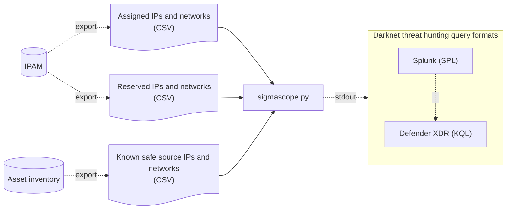

# SigmaScope

SigmaScope is [Network telescope/IP
darknet](https://en.wikipedia.org/wiki/Network_telescope) threat hunting query
generator, converting IPAM information sets into darknet-detecting search
queries, via [pySigma](https://github.com/SigmaHQ/pySigma).

The goal is to simplify the process of searching for traffic targeting IP
darknet ranges by converting collections of reserved, assigned, and know-good
source IP addresses and range information into threat hunting queries.

## Behind the scenes

SigmaScope subtracts your list of assigned IPs and networks from your list of
reserved IPs and networks, returning addresses that are reserved in your IPAM,
but not yet assigned to a known asset. Traffic targeting these addresses is
either malicious or a misconfiguration, but worthy of investigation regardless.

The collapsed list is then converted into a
[Sigma](https://sigmahq.io/docs/basics/rules.html) Rule, which is then converted
into your threat hunting query format of choice.

## Data flow



## Requirements

Python 3.14+ and [uv](https://docs.astral.sh/uv/getting-started/installation/).

## Input formats

IPAM data needs to be prepared into two files:

 - Reserved addresses (CSV): Simple list of IP addresses and ranges (CIDR format) that are reserved for future use ([example](tests/data/reserved.csv)).
 - Assigned addresses (CSV): Simple list of IP addresses and ranges (CIDR format) that are assigned to assets ([example](tests/data/assigned.csv)).

Additionally, you can provide a list of addresses or ranges (CIDR format) that
you are expecting to scan IP darknets - for instance security scanning tools
([example](tests/data/allowed.csv)).

## Usage

```
usage: sigmascope.py [-h] -t TARGET -p PIPELINE [--allowed_sources_file ALLOWED_SOURCES_FILE]
                     [--global-sigma GLOBAL_SIGMA]
                     reserved_file assigned_file

positional arguments:
  reserved_file         CSV file of reserved IP addresses and ranges (in CIDR notation)
  assigned_file         CSV file of assigned IP addresses and ranges (in CIDR notation)

options:
  -h, --help            show this help message and exit
  -t, --target TARGET   Name of target sigma.backend module - e.g., 'splunk'
  -p, --pipeline PIPELINE
                        Name of sigma.pipelines module - e.g., 'splunk_cim', or path to a pipeline YAML definition
  --allowed_sources_file ALLOWED_SOURCES_FILE
                        CSV file of known-good allowed source addresses (e.g., internal scanners)
  --global-sigma GLOBAL_SIGMA
                        Use a globally-installed sigma-cli instance instead of the bundled version
```

## Output formats

pySigma supports a [plugin
system](https://sigmahq-pysigma.readthedocs.io/en/v2.0.0/guides/plugin_system.html),
including support for plugins that provide a
[backend](https://sigmahq.io/docs/digging-deeper/backends.html) and
[pipelines](https://sigmahq.io/docs/digging-deeper/pipelines.html) for
conversion between Sigma YAML and other query languages.

SigmaScope embeds the
[splunk](https://github.com/SigmaHQ/pySigma-backend-splunk) and
[kusto](https://github.com/AttackIQ/pySigma-backend-kusto) backends but you can
add other plugins using the embedded pySigma CLI - e.g.:

 - Show installable backend plugins: `uv run sigma plugin list -t backend` (can be slow)
 - Install plugin: `uv run sigma plugin install elasticsearch`

SigmaScope copies pySigma's use of the `-t` and `-p` flags for specifying a
backend and one or more pipelines, and the following examples take advantage of
a combination of built-in and custom YAML pipelines in [pipelines/](pipelines/)
to further tune the output and reduce query verbosity.

### Splunk Search

```bash
uv run sigmascope.py -t splunk -p pipelines/splunk_cim_firewall_logs.yaml tests/data/reserved.csv tests/data/assigned.csv --allowed_sources_file tests/data/allowed.csv
dest_ip IN ("10.0.0.0/32", "10.0.0.2/31", "10.0.0.6/31", "10.0.0.8/29") NOT (src_ip IN ("10.0.1.2/32", "10.0.4.0/29"))
```

### Microsoft Defender XDR

```bash
uv run sigmascope.py -t kusto -p pipelines/defender_xdr.yaml -p microsoft_xdr tests/data/reserved.csv tests/data/assigned.csv
DeviceNetworkEvents
| where ipv4_is_in_any_range(RemoteIP, "10.0.0.0/32", "10.0.0.2/31", "10.0.0.6/31", "10.0.0.8/29")
```

## Tests

```
uv run py.test
```

## Future plans

In the future I'd like to:
 - Expand backend and pipeline support and examples
 - Allow for calling a custom sigma path
 - Add a Docker image

## Thank you

SigmaScope heavily leverages and appreciates [pySigma](https://github.com/SigmaHQ/pySigma).

These links proved invaluable too:
 - https://www.dogesec.com/blog/beginners_guide_to_using_sigma_cli_pysigma/
 - https://threatclaw.io/en/blog/sigma-to-sentinel-kql
 - https://sigmahq.io/sigma-specification/specification/sigma-appendix-taxonomy.html
 - https://sigmahq-pysigma.readthedocs.io/en/latest/guides/processing_pipelines.html
 - https://help.splunk.com/en/splunk-cloud-platform/common-information-model/5.1/data-models/cim-fields-per-associated-data-model

## AI

This project is 100% human-crafted. I do not accept pull requests, documentation, or code generated by artificial intelligence tools (LLMs). All contributions must be original work written by the author.
