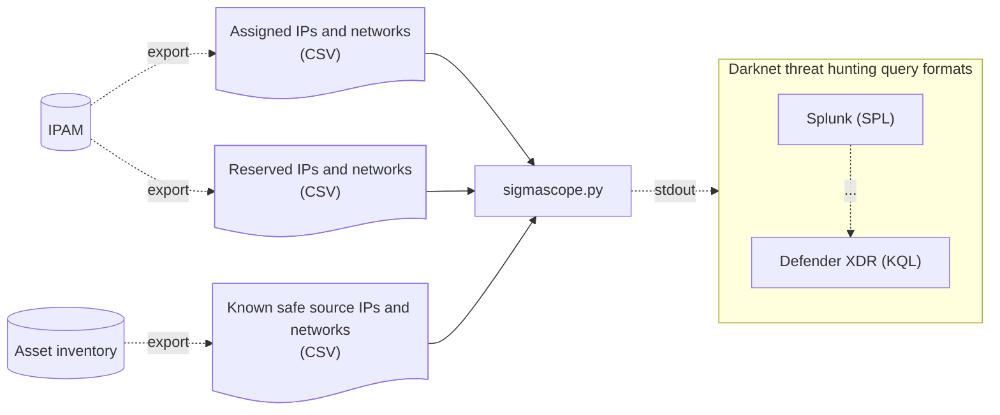

# SigmaScope (WIP)

SigmaScope is Network telescope/IP darknet threat hunting query generator.

Converts IPAM information sets into darknet-detecting SIEM queries, via Sigma.

## Purpose

The goal is to simplify the process of searching firewall logs for traffic
targeting IP darknet ranges, buy converting assigned, reserved, and know-good
source ip addresses and range information into threat hunting queries.

## Requirements

Python 3.14+ and [`uv`](https://docs.astral.sh/uv/getting-started/installation/)

## Data flow



### Output formats

Output formats are tied to [pySigma backends](https://sigmahq.io/docs/digging-deeper/backends.html).

Enable backends using uv extras (choose from `splunk`, `kusto`):
 - Splunk: `uv sync --extra splunk`
 - KQL: `uv sync --extra kusto`
 - Multiple `uv sync --extra splunk --extra kusto`
 - All of them: `uv sync --all-extras`

### Pipelines

To fine-tune output fields beyond the pipelines included in the pySigma backend
modules, use YAML pipelines in: [`src/pipelines/`](pipelines/) or create your
own.

[pySigma reference](https://sigmahq-pysigma.readthedocs.io/en/latest/guides/processing_pipelines.html)

### Input data

IPAM data needs to be prepared into two files:

#### Reserved addresses (CSV)

Simple list of IP addresses and ranges (CIDR format) that are reserved for future use.

[Example](tests/data/reserved.csv)

#### Assigned addresses (CSV)

Simple list of IP addresses and ranges (CIDR format) that are assigned to assets.

[Example](tests/data/assigned.csv)

### Allowed addresses

Additionally, you can provide a list of addresses or ranges (CIDR format) that
you are expecting to scan IP darknets - for instance security scanning tools.

[Example](tests/data/allowed.csv)

## Usage

### Python

When exporting, chose a backend and pipeline.

Pipeline tweaks field names, backend (target) does the final conversion to the
query.

```
usage: sigmascope.py [-h] -b BACKEND -p PIPELINE [--allowed_source_nets ALLOWED_SOURCE_NETS] reserved_csv assigned_csv

positional arguments:
  reserved_csv          CSV file of reserved IP addresses and ranges (in CIDR notation)
  assigned_csv          CSV file of assigned IP addresses and ranges (in CIDR notation)

options:
  -h, --help            show this help message and exit
  -b, --backend BACKEND
                        Name of sigma.backend module - e.g., 'splunk'
  -p, --pipeline PIPELINE
                        Name of sigma.pipelines module - e.g., 'splunk_cim', or path to a pipeline YAML definition
  --allowed_source_nets ALLOWED_SOURCE_NETS
                        CSV file of known-good allowed source addresses (e.g., internal scanners)
```

Examples:
```
uv run sigmascope.py -b splunk -p pipelines\splunk_cim_firewall_logs.yaml tests\data\reserved.csv tests\data\assigned.csv
uv run sigmascope.py -b splunk -p splunk_windows tests\data\reserved.csv tests\data\assigned.csv
uv run sigmascope.py -b kusto -p pipelines/defender_xdr.yaml tests\data\reserved.csv tests\data\assigned.csv --allowed_source_nets --allowed_source_nets test\data\allowed.csv
uv run sigmascope.py -b kusto -p pipelines/defender_xdr.yaml -p microsoft_xdr tests\data\reserved.csv tests\data\assigned.csv
```

## Tests

```
uv sync --all-extras
uv run py.test
```

## TODO (v1)

 - [ ] External sigma support?
 - [ ] Docker?
 - [ ] Better language on plugins vs backends vs pipelines (and -f flag)
 - [ ] Other plugins/backends?
 - [ ] Subprocess call in data flow diagram

## Thank you

sigmascope heavily leverages and appreciates `pysigma` for output generation.

These links proved invaluable too:
 - https://www.dogesec.com/blog/beginners_guide_to_using_sigma_cli_pysigma/
 - https://threatclaw.io/en/blog/sigma-to-sentinel-kql
 - https://sigmahq.io/sigma-specification/specification/sigma-appendix-taxonomy.html
 - https://sigmahq-pysigma.readthedocs.io/en/latest/guides/processing_pipelines.html
 - https://help.splunk.com/en/splunk-cloud-platform/common-information-model/5.1/data-models/cim-fields-per-associated-data-model

## AI

This project is 100% human-crafted. We do not accept pull requests, documentation, or code generated by artificial intelligence tools (LLMs). All contributions must be original work written by the author.
